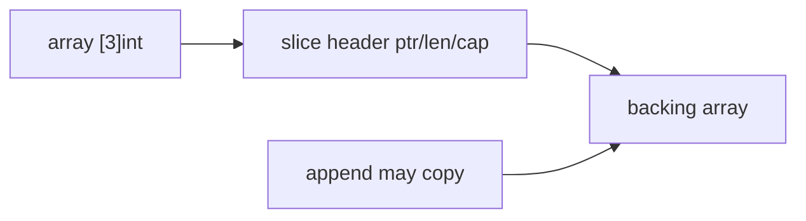

Go — Part I
How Go **organizes** code (**`package`**, **`func`**, **`struct`**), the **`go`** CLI, **modules**, zero values, slices and maps, and **`defer`** so later notes share a baseline.

## 1. Toolchain & the `go` CLI

- **[go.dev/dl](https://go.dev/dl/)** — official installers for Windows, macOS, and Linux. After install, **`go version`** should print the toolchain (these notes assume **Go 1.22+**).
- **`go`** compiles, tests, formats, fetches modules, and cross-compiles. You almost never invoke a separate linker by hand.
- **Modules** (`go.mod`) are the default since **1.16**. **`GOPATH` mode** is legacy — do not start new work there.

```text
go version
go env GOPATH GOROOT GOPROXY
```

| Command | Role |
|---------|------|
| **`go run .`** | Compile and run the current module (or a listed `.go` file) |
| **`go build`** | Compile a binary into the current directory (or **`-o name`**) |
| **`go test ./...`** | Run tests in this module |
| **`go fmt ./...`** | Format (gofmt rules — tabs, no options debate) |
| **`go vet ./...`** | Built-in static checks |
| **`go mod tidy`** | Add missing / remove unused module requirements |

### Windows notes

The MSI installer from **go.dev** is enough for pure Go. Open a **new** terminal after install so **`PATH`** includes **`go`**.

**cgo** (calling C) needs a C compiler (**TDM-GCC**, **MinGW-w64**, or MSVC). Most application code never needs cgo — prefer the pure-Go standard library.

### First module

```text
mkdir hello && cd hello
go mod init example.com/hello
```

```go
package main

import "fmt"

func main() {
	fmt.Println("hello")
}
```

```text
go run .
```

## 2. How Go code is organized

Go is **compiled**, **garbage-collected**, and **statically typed**. One **package** per directory; the package name is usually the folder name. **`package main`** plus **`func main()`** is a binary.

```text
hello/                 ← one module
  go.mod               ← module path + Go version
  main.go              ← package main (entry)
  greet/
    greet.go           ← package greet
```

| Layer | What it is | Rough Java analogy |
|-------|------------|-------------------|
| **Module** | Versioned unit (`go.mod` path) | Maven/Gradle artifact coordinates |
| **Package** | One directory of `.go` files sharing a name | Java **`package`** |
| **File** | Compilation unit inside a package | One `.java` file in that package |

**Exported** names start with a **capital letter** (`fmt.Println`). lowercase names are package-private. There is no `public` keyword.

```go
package greet

func Hello(name string) string { // exported
	return "hello, " + name
}

func shout(s string) string { // unexported
	return s + "!"
}
```

## 3. Variables, types, and zero values

- **`var x int = 3`** or short **`x := 3`** (inside functions). **`const`** is for compile-time constants.
- Every type has a **zero value** (`0`, `false`, `""`, `nil`). Declare without assigning and you still have a usable value — no uninitialized memory.
- Common types: **`int`**, **`int64`**, **`uint64`**, **`float64`**, **`bool`**, **`string`**, **`byte`** (`uint8`), **`rune`** (`int32`, Unicode code point).

```go
var n int           // 0
count := 42         // int
name := "Ada"       // string
ok := true
price := 19.99      // float64

const MaxItems = 100
```

**`string`** is immutable bytes (usually UTF-8). Range over a string yields **runes**, not bytes:

```go
for i, r := range "Go言語" {
	fmt.Printf("%d %c\n", i, r)
}
```

## 4. Control flow

Go has **one loop**: **`for`**. No `while`, no `do-while`. **`if`** and **`switch`** can include a short statement.

```go
if n := len(name); n == 0 {
	fmt.Println("empty name")
	return
}

for i := 0; i < 3; i++ {
	fmt.Println(i)
}

for _, item := range items { // slice / map / channel
	fmt.Println(item)
}

switch code {
case 200:
	return "ok"
case 404:
	return "missing"
default:
	return "other"
}
```

**`switch`** does not fall through unless you write **`fallthrough`**. Cases can be expressions (`switch { case n > 0: ... }`).

## 5. Functions

Multiple return values are idiomatic — especially **`(T, error)`**. Named results are optional.

```go
func double(x int) int {
	return x * 2
}

func divide(a, b int) (int, error) {
	if b == 0 {
		return 0, fmt.Errorf("divide by zero")
	}
	return a / b, nil
}

func main() {
	n, err := divide(10, 2)
	if err != nil {
		log.Fatal(err)
	}
	fmt.Println(n)
}
```

**`defer`** runs a call when the surrounding function returns — LIFO. Use it for **`Close()`**, unlock, cancel.

```go
f, err := os.Open("notes.txt")
if err != nil {
	return err
}
defer f.Close()
```

## 6. Arrays, slices, and maps

- **Array** `[n]T` has a **fixed** length in the type. Rare in APIs.
- **Slice** `[]T` is a view: pointer + length + capacity. **`append`** may allocate a new backing array.
- **Map** `map[K]V` — keys must be comparable. Read of a missing key returns the **zero value**; use the two-value form to distinguish missing from zero.

```go
nums := []int{1, 2, 3}
nums = append(nums, 4)

window := nums[1:3] // shares backing array — mutating window mutates nums

ages := map[string]int{"ada": 36}
ages["linus"] = 54
v, ok := ages["missing"]
if !ok {
	fmt.Println("not found", v) // v is 0
}
delete(ages, "ada")
```

Make length explicit with **`make`**:

```go
buf := make([]byte, 0, 1024)     // len 0, cap 1024
seen := make(map[string]struct{}) // set idiom
```



## 7. `struct` at a glance

A **`struct`** holds fields. Methods live as functions with a **receiver** (Part III covers pointer vs value and interfaces).

```go
type User struct {
	ID   int64
	Name string
}

func (u User) Label() string {
	return u.Name
}

u := User{ID: 1, Name: "Ada"}
fmt.Println(u.Label())
```

## 8. Program shape recap

```go
package main

import (
	"fmt"
	"os"
)

func main() {
	if len(os.Args) < 2 {
		fmt.Fprintln(os.Stderr, "usage: hello NAME")
		os.Exit(1)
	}
	fmt.Println("hello,", os.Args[1])
}
```

**Tour of Go** — [go.dev/tour](https://go.dev/tour/) is the official hands-on walkthrough (like Rustlings for Rust). Use it alongside these notes.

Next: **Part II** — **`go.mod`**, packages, and workspaces [Modules & packages](ii-modules-and-packages.md). **Part III** — [Types, interfaces & errors](iii-types-interfaces-and-errors.md). Production HTTP shapes live under [Templates — Go net/http](../../templates/controllers/v-go-nethttp.md).
