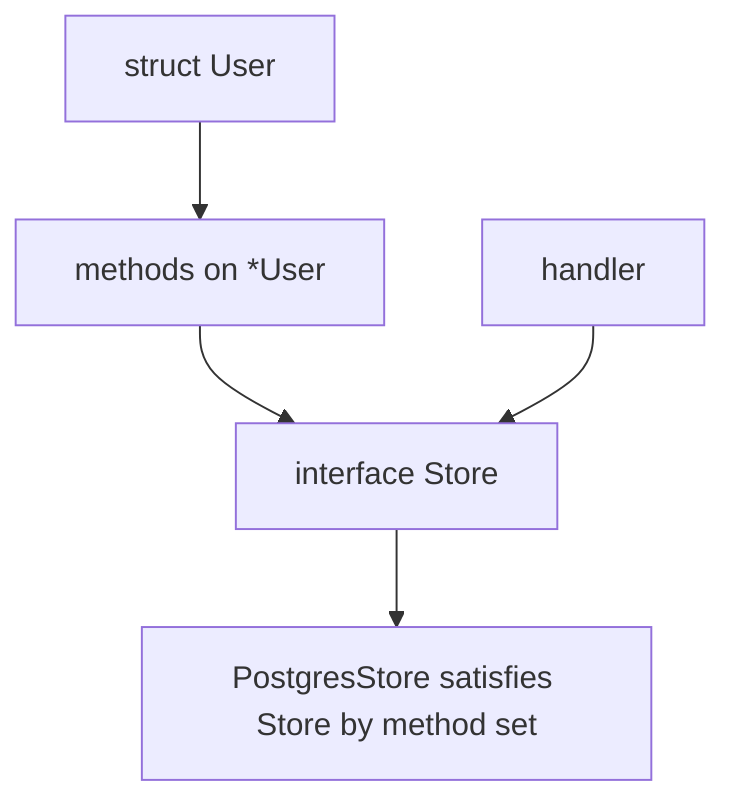

Go — Part III: Types, interfaces & errors
**`struct`** for data, **methods** on receivers, **interfaces** satisfied **implicitly**, and **`error`** as a value. This is the core of idiomatic Go — more important than inheritance (Go has none).

Assumes **Part I** [Basics & toolchain](i-basics-and-toolchain.md) (packages, slices, `struct` glance) and **Part II** [Modules & packages](ii-modules-and-packages.md).

## 1. Pointers vs values

- **`p := &u`** takes the address; **`*p`** dereferences. There is no pointer arithmetic.
- Pass a **pointer** when the method must mutate, or when the value is large and you want to avoid copies.
- Zero value of a pointer is **`nil`**. Dereferencing **`nil`** panics.

```go
type Counter struct {
	N int
}

func (c *Counter) Inc() {
	c.N++
}

func (c Counter) Value() int {
	return c.N
}

func main() {
	c := Counter{}
	c.Inc() // Go takes &c automatically for pointer receivers on addressable values
	fmt.Println(c.Value())
}
```

| Receiver | Use when |
|----------|----------|
| **`(t T)`** | Method does not mutate; small struct; you want a copy |
| **`(t *T)`** | Mutates, or avoids copying; most production methods |

**Consistency:** if any method on `T` needs `*T`, make most methods `*T` so the method set is uniform (interfaces care about this — below).

## 2. Embedding (composition)

Go has **no class inheritance**. Embed a type to promote its fields and methods.

```go
type Timestamps struct {
	CreatedAt time.Time
	UpdatedAt time.Time
}

type User struct {
	ID   string
	Name string
	Timestamps
}

u := User{ID: "1", Name: "Ada"}
u.CreatedAt = time.Now() // promoted field
```

Embedding is **not** “is-a”. It is “has these methods/fields inlined”. Name collisions are resolved at the outer type.

## 3. Interfaces — implicit satisfaction

An **interface** is a set of methods. A type **implements** it by having those methods — no `implements` keyword.

```go
type Reader interface {
	Read(p []byte) (n int, err error)
}

type Store interface {
	Find(ctx context.Context, id string) (User, error)
}
```

**Small interfaces** (1–3 methods) are the Go style. **`io.Reader`**, **`io.Writer`**, **`fmt.Stringer`** (`String() string`) show up everywhere.

```go
type User struct {
	Name string
}

func (u User) String() string {
	return u.Name
}

func PrintAll(ss ...fmt.Stringer) {
	for _, s := range ss {
		fmt.Println(s.String())
	}
}
```

### Method sets (why pointer vs value matters)

| Value you have | Methods available |
|----------------|-------------------|
| **`T`** | methods with receiver **`T`** |
| **`*T`** | methods with receiver **`T`** **and** **`*T`** |

If `Store` requires `Find` on `*PostgresStore`, a **`PostgresStore` value** does **not** implement `Store`. Use **`&PostgresStore{}`** (or keep a pointer in the variable).

### `any`

**`any`** is an alias for **`interface{}`** — a value of some type plus a type descriptor. Prefer a real interface. Use **`any`** for JSON maps, type switches, and generics constraints when you truly mean “everything”.

```go
func typeName(v any) string {
	switch t := v.(type) {
	case string:
		return "string:" + t
	case int:
		return "int"
	default:
		return fmt.Sprintf("%T", v)
	}
}
```

## 4. Errors are values

The built-in **`error`** interface is:

```go
type error interface {
	Error() string
}
```

Return **`(T, error)`**. Check **`err != nil`** at the call site. Do **not** use exceptions for control flow.

```go
func LoadUser(ctx context.Context, id string) (User, error) {
	if id == "" {
		return User{}, fmt.Errorf("load user: empty id")
	}
	u, err := repo.Find(ctx, id)
	if err != nil {
		return User{}, fmt.Errorf("load user %s: %w", id, err)
	}
	return u, nil
}
```

| Tool | Role |
|------|------|
| **`fmt.Errorf("...: %w", err)`** | Wrap — keeps the chain for **`errors.Is` / `As`** |
| **`errors.Is(err, sql.ErrNoRows)`** | Compare to a sentinel |
| **`errors.As(err, &target)`** | Unwrap to a concrete type |
| **`errors.Join`** | Combine several errors (Go 1.20+) |

```go
var ErrNotFound = errors.New("not found")

type HTTPError struct {
	Status int
	Msg    string
	Err    error
}

func (e *HTTPError) Error() string { return e.Msg }
func (e *HTTPError) Unwrap() error { return e.Err }

func mapErr(err error) int {
	var he *HTTPError
	switch {
	case errors.As(err, &he):
		return he.Status
	case errors.Is(err, ErrNotFound):
		return 404
	default:
		return 500
	}
}
```

REST mapping of domain errors: [Templates — errors (Go)](../../templates/errors/v-go-nethttp.md).

### `panic` and `recover`

**`panic`** aborts the goroutine (then runs defers). **`recover`** only inside **`defer`**. Use panic for truly impossible states (index bugs), not for “file not found”. HTTP servers recover at the edge so one handler panic does not kill the process — see [Templates — middleware (Go)](../../templates/middleware/v-go-nethttp.md).

## 5. Generics (Go 1.18+)

Type parameters on functions and types. Constraints are **interfaces** (including unions).

```go
func Keys[K comparable, V any](m map[K]V) []K {
	out := make([]K, 0, len(m))
	for k := range m {
		out = append(out, k)
	}
	return out
}

type Result[T any] struct {
	Val T
	Err error
}
```

**`comparable`** is the constraint for map keys. Prefer generics for **containers and helpers**; do not generic-ize every repository — a small interface is usually clearer.

## 6. JSON tags

Exported fields + struct tags drive **`encoding/json`**.

```go
type createItemRequest struct {
	Name string `json:"name"`
}

type Item struct {
	ID        string    `json:"id"`
	Name      string    `json:"name"`
	CreatedAt time.Time `json:"createdAt"`
	Secret    string    `json:"-"` // omitted
}
```

Unknown JSON fields are ignored by default. **`json.Decoder`** + **`DisallowUnknownFields()`** is stricter for public APIs.

## 7. Mental map vs Java / Python

| Concept | Go | Java | Python |
|---------|----|------|--------|
| Data | **`struct`** | class fields / record | class / dataclass |
| Methods | **`func (t T)`** | methods in the class | methods on `self` |
| Polymorphism | **interface** (implicit) | `implements` | duck typing / Protocol |
| Errors | **`error` value** | exceptions | exceptions |
| Null | **`nil`** on pointers, slices, maps, interfaces | `null` | `None` |



Next: **Part IV** — goroutines, channels, and `context` [Concurrency](iv-concurrency.md). HTTP handlers using these types: [Templates — controllers (Go)](../../templates/controllers/v-go-nethttp.md).
