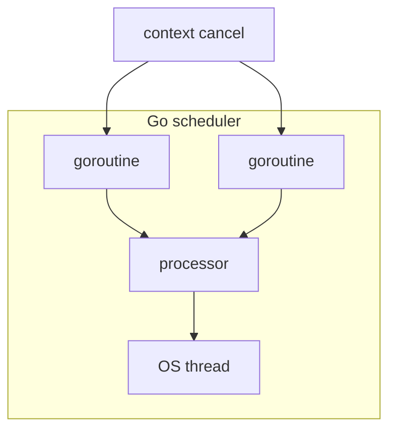

Go — Part IV: Concurrency
**Goroutines** are cheap concurrent functions. **Channels** pass values between them. **`context.Context`** carries deadlines and cancellation. The compiler will not save you from data races — **`go test -race`** will.

Assumes **Part III** [Types, interfaces & errors](iii-types-interfaces-and-errors.md). Copy-paste fan-out for HTTP services: [Templates — concurrency (Go)](../../templates/concurrency/v-go-nethttp.md).

## 1. Goroutines

**`go f()`** starts `f` on the Go scheduler (M:N: many goroutines on fewer OS threads). `main` returning **exits the process** — it does not wait for other goroutines.

```go
func main() {
	var wg sync.WaitGroup
	wg.Add(2)
	go func() {
		defer wg.Done()
		fmt.Println("a")
	}()
	go func() {
		defer wg.Done()
		fmt.Println("b")
	}()
	wg.Wait()
}
```

Loop variable capture (pre-1.22 you **must** copy; 1.22+ per-iteration variables are new each time — still copy if you target older Go):

```go
for _, id := range ids {
	id := id
	go func() { fetch(id) }()
}
```

## 2. Channels

A **channel** is a typed pipe. Send **`ch <- v`**, receive **`v := <-ch`**. **Unbuffered** send blocks until a receiver is ready. **Buffered** (`make(chan T, n)`) holds `n` values.

```go
ch := make(chan string)
go func() {
	ch <- "done"
}()
fmt.Println(<-ch)
```

**Close** the channel to signal “no more sends”. Receivers see **`v, ok := <-ch`** with `ok == false` after close. **Only the sender closes.** Receiving from closed yields the zero value. Sending on closed **panics**.

```go
func producer(n int) <-chan int {
	out := make(chan int)
	go func() {
		defer close(out)
		for i := 0; i < n; i++ {
			out <- i
		}
	}()
	return out
}

for v := range producer(3) {
	fmt.Println(v)
}
```

Return **`<-chan T`** (receive-only) from producers so callers cannot send.

### `select`

**`select`** waits on several channel operations. Random choice if several are ready. **`default`** is non-blocking.

```go
select {
case v := <-ch:
	fmt.Println("got", v)
case <-ctx.Done():
	return ctx.Err()
case <-time.After(2 * time.Second):
	return errors.New("timeout")
}
```

## 3. `context.Context`

Pass **`ctx`** as the **first argument** of I/O functions. It is not for optional params — use a struct for those.

| Call | Meaning |
|------|---------|
| **`context.Background()`** | Root in `main` / tests |
| **`context.WithCancel(parent)`** | Manual cancel |
| **`context.WithTimeout(parent, d)`** | Deadline = now + d |
| **`context.WithValue`** | Request-scoped keys (trace ID) — not a DI bag |

```go
func Fetch(ctx context.Context, url string) error {
	req, err := http.NewRequestWithContext(ctx, http.MethodGet, url, nil)
	if err != nil {
		return err
	}
	resp, err := http.DefaultClient.Do(req)
	if err != nil {
		return err
	}
	defer resp.Body.Close()
	_, err = io.Copy(io.Discard, resp.Body)
	return err
}

ctx, cancel := context.WithTimeout(context.Background(), 3*time.Second)
defer cancel()
if err := Fetch(ctx, "https://example.com"); err != nil {
	log.Print(err)
}
```

When **`ctx` is cancelled**, in-flight HTTP, DB drivers, and **`select` on `ctx.Done()`** should stop. Always **`defer cancel()`** on the function that created the derived context.

## 4. `sync` primitives

| Type | Role |
|------|------|
| **`sync.WaitGroup`** | Wait for a known set of goroutines |
| **`sync.Mutex` / `RWMutex`** | Protect shared memory |
| **`sync.Once`** | Init exactly once |
| **`sync.Map`** | Rare — special concurrent map; prefer `map` + mutex |
| **`sync.Pool`** | Reuse buffers; be careful with lifetime |

```go
type Cache struct {
	mu    sync.RWMutex
	items map[string]string
}

func (c *Cache) Get(k string) (string, bool) {
	c.mu.RLock()
	defer c.mu.RUnlock()
	v, ok := c.items[k]
	return v, ok
}

func (c *Cache) Set(k, v string) {
	c.mu.Lock()
	defer c.mu.Unlock()
	c.items[k] = v
}
```

**Share memory by communicating** (channels) when ownership is a pipeline. Use a **mutex** when many readers need a cache or registry. Do not mix “maybe I’ll lock” — document which goroutine owns the data.

## 5. `errgroup` and bounded fan-out

**`golang.org/x/sync/errgroup`** runs goroutines and returns the first error, cancelling siblings if you use **`WithContext`**.

```go
g, ctx := errgroup.WithContext(ctx)
g.Go(func() error { return loadA(ctx) })
g.Go(func() error { return loadB(ctx) })
if err := g.Wait(); err != nil {
	return err
}
```

Bound parallelism with a **semaphore channel** so 10,000 IDs do not start 10,000 goroutines at once — full pattern in [Templates — concurrency (Go)](../../templates/concurrency/v-go-nethttp.md).

## 6. Data races

A **data race** is two goroutines accessing the same variable, at least one writing, without synchronization. **Undefined behavior.**

```text
go test -race ./...
go run -race .
```

Run **`-race`** in CI on your test suite. It is slower and uses more memory; not always on in production.

```go
// BAD: race
var n int
go func() { n++ }()
go func() { n++ }()

// GOOD: atomic or mutex
var n atomic.Int64
go func() { n.Add(1) }()
```

## 7. Mental model vs other stacks

| Stack | Unit of concurrency | Typical footgun |
|-------|---------------------|-----------------|
| **Go** | Goroutine (cheap) | Unbounded fan-out, forgotten `Wait`, races on maps |
| **Java Spring MVC** | OS thread from a pool | Pool exhaustion on blocking I/O |
| **Node / asyncio** | Event loop | Blocking the loop with CPU or sync I/O |
| **Rust async** | Future + runtime | Blocking inside `async`, missing `Send` |



**`net/http`** already starts a goroutine per request. Your job is **not** “add more threads” — it is timeouts, bounded outbound calls, and no shared mutable maps without a lock.

Next: **Part V** — [Testing & tooling](v-testing-and-tooling.md) (`go test`, race in CI). **Part VI** — [HTTP servers & CLI](vi-http-and-cli.md).
