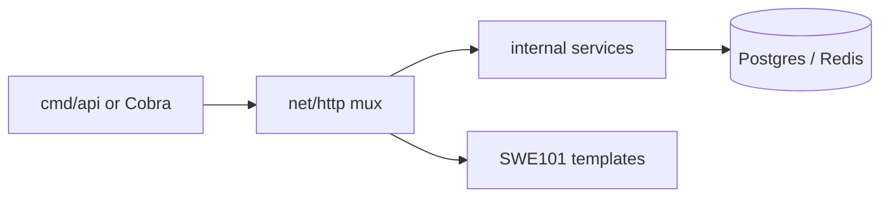

Go — Part VI: HTTP servers & CLI
The standard library **`net/http`** is enough for many APIs. **Cobra** (and **`flag`**) cover CLIs. Cross-compile with **`GOOS`/`GOARCH`**. Layered REST code lives in **Templates** — this note is the language-level wiring.

See **Part II** [Modules & packages](ii-modules-and-packages.md) for **`cmd/`** layout, **Part IV** [Concurrency](iv-concurrency.md) for goroutines per request, **Part V** [Testing & tooling](v-testing-and-tooling.md) for **`httptest`**.

## 1. `net/http` (Go 1.22+ mux)

**`http.ListenAndServe`** binds a handler. **`http.NewServeMux`** method+path patterns (`GET /items/{id}`) are first-class since **1.22**.

```go
package main

import (
	"encoding/json"
	"log"
	"net/http"
)

func main() {
	mux := http.NewServeMux()
	mux.HandleFunc("GET /health", func(w http.ResponseWriter, r *http.Request) {
		w.Header().Set("Content-Type", "application/json")
		json.NewEncoder(w).Encode(map[string]string{"status": "ok"})
	})
	mux.HandleFunc("GET /items/{id}", getItem)

	log.Fatal(http.ListenAndServe(":8080", mux))
}

func getItem(w http.ResponseWriter, r *http.Request) {
	id := r.PathValue("id")
	_ = id
	http.Error(w, "not implemented", http.StatusNotImplemented)
}
```

Prefer **`http.Server`** with timeouts instead of bare **`ListenAndServe`**:

```go
srv := &http.Server{
	Addr:              ":8080",
	Handler:           mux,
	ReadHeaderTimeout: 5 * time.Second,
	ReadTimeout:       15 * time.Second,
	WriteTimeout:      15 * time.Second,
	IdleTimeout:       60 * time.Second,
}
log.Fatal(srv.ListenAndServe())
```

Graceful shutdown: **`srv.Shutdown(ctx)`** on **`SIGINT`/`SIGTERM`**.

## 2. Middleware

A middleware is **`func(http.Handler) http.Handler`**. Wrap logging, request IDs, auth, recover. Full stubs: [Templates — middleware (Go)](../../templates/middleware/v-go-nethttp.md).

```go
type ctxKeyID struct{}

func withRequestID(next http.Handler) http.Handler {
	return http.HandlerFunc(func(w http.ResponseWriter, r *http.Request) {
		id := r.Header.Get("X-Request-ID")
		if id == "" {
			id = "req-" + strconv.FormatInt(time.Now().UnixNano(), 10)
		}
		ctx := context.WithValue(r.Context(), ctxKeyID{}, id)
		w.Header().Set("X-Request-ID", id)
		next.ServeHTTP(w, r.WithContext(ctx))
	})
}

func main() {
	mux := http.NewServeMux()
	// ... register routes
	handler := withRequestID(mux)
	log.Fatal(http.ListenAndServe(":8080", handler))
}
```

## 3. JSON handlers

Decode with a **limit** on body size; encode with an explicit status. DTO vs domain split: [Templates — DTOs (Go)](../../templates/dtos/v-go-nethttp.md), [controllers (Go)](../../templates/controllers/v-go-nethttp.md).

```go
func createItem(w http.ResponseWriter, r *http.Request) {
	r.Body = http.MaxBytesReader(w, r.Body, 1<<20)
	var req struct {
		Name string `json:"name"`
	}
	if err := json.NewDecoder(r.Body).Decode(&req); err != nil {
		http.Error(w, "invalid json", http.StatusBadRequest)
		return
	}
	w.Header().Set("Content-Type", "application/json")
	w.WriteHeader(http.StatusCreated)
	json.NewEncoder(w).Encode(map[string]string{"name": req.Name})
}
```

## 4. When to add a framework

| Need | Standard library | Common extra |
|------|------------------|--------------|
| Routing, JSON, timeouts | **`net/http`** | — |
| Chi / Echo / Gin | Extra mux, sugar | Fine if the team already uses them |
| OpenAPI codegen | — | **oapi-codegen**, **Connect** |
| gRPC | — | **google.golang.org/grpc** |

These notes and the **Templates** track stay on **`net/http`** so the patterns transfer. Frameworks wrap the same **`http.Handler`**.

## 5. CLI tools

**`flag`** in **`std`** is enough for small tools. **[Cobra](https://github.com/spf13/cobra)** is the usual choice for nested commands (`kubectl`, `hugo`, `gh` style).

```go
package main

import (
	"flag"
	"fmt"
)

func main() {
	name := flag.String("name", "world", "who to greet")
	flag.Parse()
	fmt.Println("hello,", *name)
}
```

Cobra sketch:

```go
root := &cobra.Command{
	Use:   "billing",
	Short: "Billing CLI",
}
serve := &cobra.Command{
	Use:   "serve",
	Short: "Run the HTTP API",
	RunE: func(cmd *cobra.Command, args []string) error {
		return runServer(cmd.Context())
	},
}
root.AddCommand(serve)
if err := root.Execute(); err != nil {
	os.Exit(1)
}
```

SWE101 overview lists **Cobra (Go)** next to Click (Python) and Clap (Rust) for CLI products.

## 6. Ship a binary

```text
CGO_ENABLED=0 GOOS=linux GOARCH=amd64 go build -trimpath -ldflags="-s -w" -o api ./cmd/api
```

| Flag | Why |
|------|-----|
| **`CGO_ENABLED=0`** | Avoid libc coupling on Linux |
| **`-trimpath`** | Reproducible paths in the binary |
| **`-ldflags="-s -w"`** | Smaller binary (strip symbols) |

**[GoReleaser](https://goreleaser.com/)** automates multi-OS archives, checksums, and GitHub Releases. Container: a **distroless** or **scratch** image with the static binary + CA certs (`FROM alpine` or copy **`ca-certificates`**).

```text
# Dockerfile sketch
FROM golang:1.22 AS build
WORKDIR /src
COPY go.mod go.sum ./
RUN go mod download
COPY . .
RUN CGO_ENABLED=0 go build -o /api ./cmd/api

FROM gcr.io/distroless/static-debian12
COPY --from=build /api /api
ENTRYPOINT ["/api"]
```

## 7. Where to go next in this repo

| Topic | Note |
|-------|------|
| REST layers | [Templates overview](../../templates/i-overview.md) — controllers, DTOs, services, repositories |
| Concurrency in handlers | [Templates — concurrency (Go)](../../templates/concurrency/v-go-nethttp.md) |
| Errors → HTTP | [Templates — errors (Go)](../../templates/errors/v-go-nethttp.md) |
| Observability | [Templates — observability (Go)](../../templates/observability/v-go-nethttp.md), [SRE101 Prometheus](../../../sre101/tooling/prometheus/iii-instrumentation.md) (`client_golang`) |
| Schema migrations | [Postgres migrations](../../databases/postgres/iii-schema-and-migrations.md) (**golang-migrate**) |



Official docs: [go.dev/doc](https://go.dev/doc/), [Effective Go](https://go.dev/doc/effective_go), [Go module reference](https://go.dev/ref/mod).
